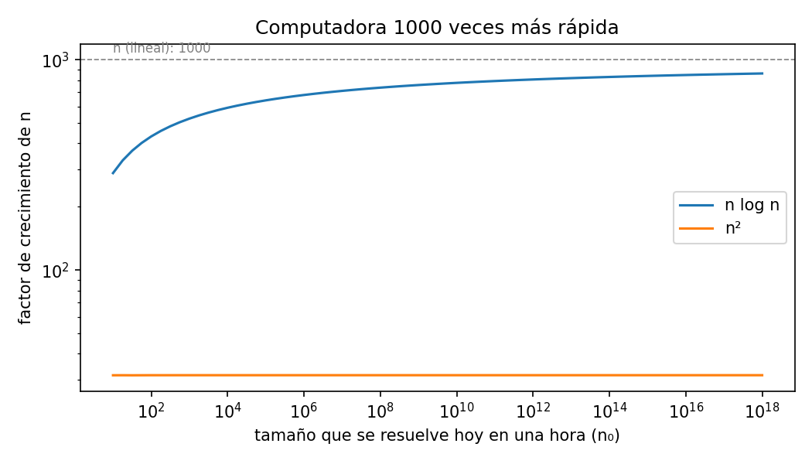

# Ejercicio 1: una computadora mil veces más rápida

> ★ Una computadora mil veces más rápida. ¿Cuánto crece el tamaño de entrada que se
> resuelve en una hora con un algoritmo $\Theta(n^2)$? ¿Y con uno $\Theta(n \log n)$?
> Estima los dos factores. (C1)

**Código:** [`ejercicio-01.py`](ejercicio-01.py). Imprime las tablas, comprueba con
`assert` que las estimaciones coinciden con lo que se mide y genera la figura. Todos
los números de este documento salen de ese script o de cuentas que se muestran paso a
paso.

## Modelo y supuestos

- $n_0$ es el tamaño de entrada que se resuelve **hoy** en una hora, y $n_1$ el que
  se resuelve en una hora con la computadora mil veces más rápida. El ejercicio pide
  el **factor** $f = n_1 / n_0$.
- No sabemos cuántas operaciones por segundo hace la computadora, y no hace falta. Lo
  único que usamos es que la nueva hace, en el mismo tiempo, **1000 veces más
  operaciones** que la de hoy.
- Tomamos el costo del algoritmo como **exactamente** $T(n) = n^2$ o
  $T(n) = n \log_2 n$. Las constantes que esconde la $\Theta$ se discuten al final.

Como hoy se gastan $T(n_0)$ operaciones en una hora y la nueva hace 1000 veces más:

$$
T(n_1) = 1000\, T(n_0). \tag{$*$}
$$

(En rigor $n_1$ es el mayor entero que cumple $T(n_1) \le 1000\,T(n_0)$, y la
igualdad es aproximada. El script mide ese entero y se ve que la diferencia es
mínima.)

## $\Theta(n^2)$: el factor es $\sqrt{1000} \approx 31{,}6$

Con $T(n) = n^2$, la ecuación $(*)$ es

$$
n_1^2 = 1000\, n_0^2 .
$$

$$
n_1 = \sqrt{1000\, n_0^2} = \sqrt{1000}\cdot\sqrt{n_0^2} = \sqrt{1000}\; n_0
\qquad\Longrightarrow\qquad f = \frac{n_1}{n_0} = \sqrt{1000} \approx 31{,}62 .
$$

**El factor no depende de nada más.** En la cuenta no aparece $n_0$, así que el factor es
el mismo sin importar cuánto se resuelva hoy, y por lo tanto sin importar la
velocidad de la computadora. Tampoco depende de una constante:
si el costo es $c\,n^2$, la ecuación queda $c\,n_1^2 = 1000\,c\,n_0^2$, y al dividir
entre $c$ se vuelve a la misma. Mil veces más potencia de cómputo da entradas apenas 32
veces más grandes.

## $\Theta(n \log n)$: el factor es casi 1000, pero no llega

### La ecuación del factor

Por $(*)$, buscamos $n_1$ tal que

$$
n_1 \log_2 n_1 = 1000\, n_0 \log_2 n_0 .
$$

No podemos despejar $n_1$, porque aparece afuera **y** adentro del logaritmo. Por eso
hacemos la sustitución $n_1 = f n_0$, donde $f$ es justo el factor que buscamos:

$$
f n_0 \log_2(f n_0) = 1000\, n_0 \log_2 n_0 .
$$

1. **Dividimos los dos lados entre $n_0$**, que es positivo:
   $f \log_2(f n_0) = 1000 \log_2 n_0$.
2. **El logaritmo de un producto es la suma de los logaritmos:**
   $\log_2(f n_0) = \log_2 f + \log_2 n_0$, así que
   $f(\log_2 f + \log_2 n_0) = 1000 \log_2 n_0$.
3. **Dividimos los dos lados entre $\log_2 n_0$.** Hace falta que no sea 0, y en
   efecto es positivo si suponemos $n_0 \ge 2$, es decir, que hoy en una hora se
   resuelve al menos una entrada de tamaño 2. Entonces $\log_2 n_0 \ge 1 > 0$. (Con
   $n_0 = 1$ tendríamos $\log_2 1 = 0$ y no se podría dividir.) Repartiendo la
   fracción,
   $\frac{a + b}{b} = \frac{a}{b} + 1$:

   $$
   f\left(\frac{\log_2 f}{\log_2 n_0} + 1\right) = 1000 . \tag{1}
   $$

La base del logaritmo no importa. Por cambio de base,
$\log_b x = \log_2 x / \log_2 b$, así que en el cociente
$\log_b f / \log_b n_0$ el factor $1/\log_2 b$ aparece arriba y abajo y se cancela.
Usamos $\log_2$ para que coincida con el script.

### Lo que dice la ecuación (1) sin resolverla

En (1) no se puede aislar $f$, pero igual se pueden sacar dos conclusiones.

1. **$f < 1000$.** Con más operaciones cabe una entrada más grande, así que
   $n_1 > n_0$, o sea $f > 1$. Entonces $\log_2 f > 0$ y el paréntesis de (1) es
   mayor que 1. Como $f$ por algo mayor que 1 da 1000, $f$ tiene que ser menor que
   1000.
2. **$f \to 1000$ cuando $n_0 \to \infty$.** Por el punto anterior,
   $1 < f < 1000$, así que $0 < \log_2 f < \log_2 1000 \approx 9{,}97$. El numerador
   de $\log_2 f / \log_2 n_0$ está acotado y el denominador crece sin límite, así que
   el cociente tiende a 0. Entonces el paréntesis de (1) tiende a 1 y $f$ tiende a
   1000. Cuanto mayor es el problema, más se parece $n \log n$ a un algoritmo lineal.

## Comprobación

Como no sabemos cuánto se resuelve hoy en una hora, el script prueba muchos valores de
$n_0$, desde 10 hasta $10^{17}$. Para cada uno **mide** el factor: busca, con
`mayor_n` de la conferencia 1, el mayor $n_1$ con $T(n_1) \le 1000\,T(n_0)$ y lo
divide entre $n_0$. Lo compara con la solución de la ecuación (1), que el script
obtiene con una búsqueda binaria de $f$ entre 1 y 1000. 

```
      n0  f medido (n^2)  f medido (nlogn)  f por ec. (1)
   1e+01           31.60            288.90         288.95
   1e+03           31.62            524.50         524.50
   1e+05           31.62            640.49         640.49
   1e+07           31.62            710.55         710.55
   1e+09           31.62            757.61         757.61
   1e+11           31.62            791.46         791.46
   1e+13           31.62            816.98         816.98
   1e+15           31.62            836.93         836.93
   1e+17           31.62            852.95         852.95
```

Las dos últimas columnas son el mismo $f$ obtenido de dos maneras: **medido** (el
mayor $n_1$ entero con $T(n_1) \le 1000\,T(n_0)$, dividido entre $n_0$) y
**calculado** con la ecuación (1). Que coincidan comprueba que la ecuación está bien
deducida.

Los `assert` comprueban que el factor de $n^2$ es siempre $\sqrt{1000}$, que el de
$n \log n$ es menor que 1000, que lo medido y la ecuación (1) coinciden y que el
factor de $n \log n$ sube al crecer $n_0$.



- **$n^2$, la recta naranja.** El factor es siempre $\sqrt{1000} \approx 31{,}6$,
  como dice la cuenta.
- **$n \log n$, la curva azul.** Es menor que 1000 y sube lentamente hacia 1000 sin
  llegar nunca. Por ejemplo, si hoy se resuelven
  entradas de tamaño $10^9$, el factor es 758.

## La constante no cambia la ecuación

Si el costo es $c\, n^2$ o $c\, n \log_2 n$, la constante $c$ aparece a los dos lados
de $(*)$, y al dividir entre $c$ se vuelve a la misma ecuación. Así que el factor
solo depende de $n_0$, como antes.

## Conclusión

Con un algoritmo cuadrático la entrada crece solo el 3,2 % ($31{,}6/1000$) de lo que
crecería con uno lineal. Con uno $n \log n$ crece casi lo mismo que con uno lineal, y
más cuanto más grande es el problema. Por eso mejorar el algoritmo vale más que
esperar una mejor computadora.
