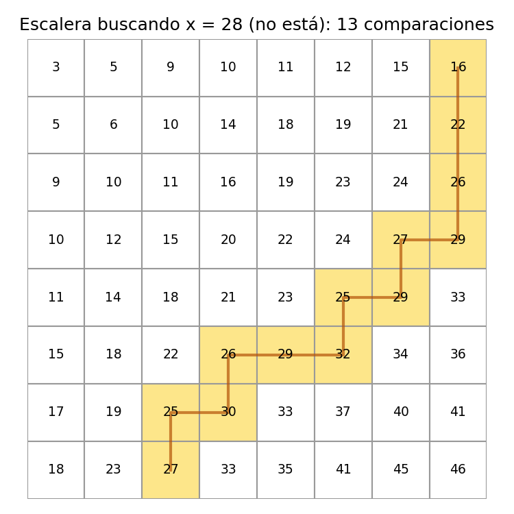
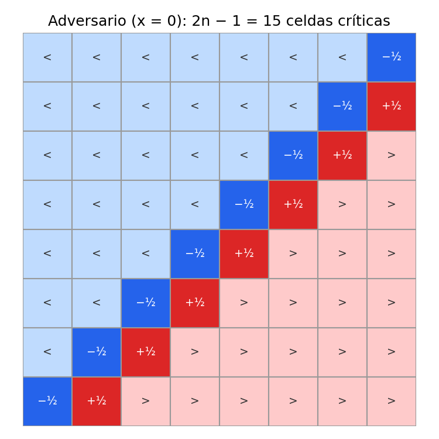

# Ejercicio 6: buscar en una matriz ordenada por filas y columnas

> ★★ Una matriz $n \times n$ tiene filas y columnas ordenadas de forma creciente.
> Diseña un algoritmo que decida si contiene un valor $x$ en $O(n)$ comparaciones,
> demuestra su correctitud con un invariante, y demuestra con un adversario que no se
> puede en $o(n)$. (C3, C5)

**Código:** [`ejercicio-06.py`](ejercicio-06.py). Prueba 3000 matrices aleatorias con
el invariante y el potencial vigilados, implementa el adversario y lo enfrenta a varios
algoritmos, y genera las dos figuras.

**Resultado:** el algoritmo hace a lo sumo $2n - 1$ comparaciones, y el adversario
obliga a **cualquier** algoritmo a hacer $2n - 1$. La cota superior y la inferior
coinciden exactamente, no solo en orden de magnitud.

## Problema y modelo

**Entrada:** una matriz $A[0..n-1][0..n-1]$ con $A[i][j] < A[i][j+1]$ y
$A[i][j] < A[i+1][j]$, y un valor $x$. **Salida:** una posición $(i, j)$ con
$A[i][j] = x$, o "no está". **Modelo:** comparaciones de tres vías entre $x$ y una
entrada de la matriz, cada una de costo 1, como la búsqueda binaria de la
conferencia 5. Al final se comenta qué pasa si también se permite comparar entradas
entre sí.

## Algoritmo: la escalera

La idea es empezar por la esquina superior derecha. Ese elemento es el **mayor de su
fila** y el **menor de su columna**, así que una sola comparación con él descarta una
fila entera o una columna entera.

```python
def escalera(A, x):
    n = len(A)
    i, j = 0, n - 1
    while i < n and j >= 0:
        if x == A[i][j]:
            return (i, j)
        if x < A[i][j]:
            j -= 1        # la columna j, de la fila i para abajo, es toda > x
        else:
            i += 1        # la fila i, de la columna j a la izquierda, es toda < x
    return None
```



La figura muestra el recorrido buscando $x = 28$, que no está en la matriz. Cada paso
baja o va a la izquierda, y en 13 comparaciones el camino sale de la matriz.

## Correctitud parcial: el invariante

Llamamos $R(i, j)$ a la submatriz de las filas $i..n-1$ y las columnas $0..j$, que es
la esquina inferior izquierda que todavía no se ha descartado.

$$
I:\quad x \text{ no aparece en ninguna celda de } A \text{ fuera de } R(i,j).
$$

**Inicialización.** Con $i = 0$ y $j = n-1$, $R$ es toda la matriz y no hay nada
fuera de ella.

**Mantenimiento.** Suponemos $I$ y que $i < n$, $j \ge 0$. Si $x = A[i][j]$ se
devuelve una posición correcta. Si no:

- **$x < A[i][j]$.** Para toda fila $a \ge i$, como las columnas crecen,
  $A[a][j] \ge A[i][j] > x$. Así que $x$ no está en la columna $j$ dentro de $R$. Al
  hacer `j -= 1`, lo que sale de $R$ es justamente esa columna, y $I$ se conserva.
- **$x > A[i][j]$.** Para toda columna $b \le j$, como las filas crecen,
  $A[i][b] \le A[i][j] < x$. Así que $x$ no está en la fila $i$ dentro de $R$. Al hacer
  `i += 1`, lo que sale de $R$ es esa fila, y $I$ se conserva.

**Conclusión.** Si el ciclo termina sin devolver nada, es porque $i = n$ o $j = -1$, y
en los dos casos $R(i,j)$ está vacía. Por $I$, $x$ no aparece en ninguna celda de $A$,
así que "no está" es la respuesta correcta.

## Terminación y costo: el potencial

$$
\Phi = (n - i) + (j + 1) \quad = \text{filas vivas} + \text{columnas vivas}.
$$

- Al principio $\Phi = 2n$.
- Cada iteración hace una comparación y baja $\Phi$ en **exactamente** 1, porque o
  $i$ sube o $j$ baja.
- El ciclo se detiene apenas uno de los dos sumandos llega a 0. Cuando eso pasa, el
  otro sumando todavía vale al menos 1, porque cada paso cambia uno solo.

Por lo tanto el ciclo termina, y lo hace en como máximo $2n - 1$ iteraciones:

$$
\boxed{\text{comparaciones} \le 2n - 1}
$$

La memoria usada es $O(1)$ además de la matriz.

## Cota mínima: un adversario que obliga a $2n - 1$ comparaciones

1. El algoritmo pregunta "¿cómo es $x$ comparado con $A[i][j]$?", y el adversario
   responde $<$, $=$ o $>$.
2. La única regla para el adversario es no hacer trampa: en todo momento tiene que
   existir **alguna** matriz ordenada que sea consistente con todas las respuestas que
   dio.
3. Cuando el algoritmo se detiene, da su respuesta: "está en $(i, j)$" o "no está".
   Entonces el adversario intenta **llevarle la contraria**: busca una matriz
   ordenada, consistente con todas las respuestas, donde esa respuesta sea
   incorrecta. Si la encuentra, el algoritmo no es correcto, porque con esa matriz
   como entrada habría recibido exactamente las mismas respuestas, habría hecho lo
   mismo y se habría equivocado.

Para demostrar la cota hay que dar una estrategia con la que el adversario le lleve la
contraria a **cualquier** algoritmo que haga menos de $2n - 1$ comparaciones,
responda lo que responda.

### La estrategia: responder según dos antidiagonales

Tomamos $x = 0$. El adversario responde como si la matriz fuera esta:

| celdas                                     | valor                 | respuesta a "x vs celda" |
| ------------------------------------------ | --------------------- | ------------------------ |
| i + j < n − 1                             | i + j − n (negativo) | x > celda                |
| i + j = n − 1 (antidiagonal D1, n celdas) | −½                  | x > celda                |
| i + j = n (antidiagonal D2, n − 1 celdas) | +½                   | x < celda                |
| i + j > n                                  | i + j (positivo)      | x < celda                |



En la figura, con $n = 8$, las celdas azul claro, marcadas con "<", son menores que
$x$, las rojo claro, marcadas con ">", son mayores, y las dos antidiagonales del medio son $D_1$ ($-\tfrac12$) y $D_2$
($+\tfrac12$).

Llamamos $M$ a esta matriz. Sus filas y columnas crecen, porque el valor solo depende
de $i + j$ y crece con él. Como el adversario responde exactamente lo que diría $M$,
la regla 2 se cumple siempre: $M$ es consistente con todo. Y como ninguna celda de
$M$ vale 0, **nunca** responde "$=$".

Llamamos **críticas** a las $2n - 1$ celdas de $D_1 \cup D_2$.

### Por qué justo esas celdas: son las únicas donde podría estar $x$

Una matriz ordenada puede tener $x = 0$ en la celda $c$ solo si todo lo que está
arriba o a la izquierda de $c$ es menor que 0 y todo lo que está abajo o a la derecha
es mayor. Miremos qué celdas de $M$ se pueden cambiar a 0 sin romper el orden:

- **Una celda con $i + j \le n - 2$ no se puede.** Su vecino de abajo o el de la
  derecha está en $i + j + 1 \le n - 1$, donde $M$ vale $-\tfrac12$ o menos, es decir,
  menos que 0. Si la celda valiera 0, tendría debajo algo menor.
- **Una celda con $i + j \ge n + 1$ tampoco.** Su vecino de arriba o el de la
  izquierda está en $i + j - 1 \ge n$, donde $M$ vale $+\tfrac12$ o más.
- **Una celda crítica sí se puede.** Si $c \in D_1$, arriba y a la izquierda tiene
  celdas de $i + j = n - 2$, que valen $-2 < 0$, y abajo y a la derecha tiene celdas
  de $D_2$, que valen $+\tfrac12 > 0$. Si $c \in D_2$, arriba y a la izquierda tiene
  celdas de $D_1$, que valen $-\tfrac12 < 0$, y abajo y a la derecha celdas de
  $i + j = n + 1$, que valen $n + 1 > 0$. Como solo cambia una celda y queda entre sus
  vecinos, la matriz sigue ordenada.

Así que, mientras el algoritmo no haya preguntado por una celda crítica, el adversario
puede "esconder" $x$ ahí.

Cuando el algoritmo se detiene, hay tres casos posibles, según lo que responda:

- **Responde "está en $(i, j)$".** El adversario muestra la matriz $M$. Es ordenada,
  es consistente con todas las respuestas (son las suyas) y no tiene ningún 0. La
  respuesta es incorrecta, sin importar cuántas comparaciones haya hecho el
  algoritmo. Un algoritmo correcto **solo** puede decir "está" si alguna vez oyó
  "$=$", y este adversario nunca lo dice.
- **Responde "no está" sin haber preguntado por alguna celda crítica $c$.** El
  adversario muestra la matriz $B$, que es igual a $M$ salvo que $B[c] = 0$. Por el
  apartado anterior $B$ es ordenada, y es consistente con todas las respuestas porque
  el algoritmo nunca preguntó por $c$ y las demás celdas valen lo mismo que en $M$.
  En $B$, $x$ sí está (en $c$), así que la respuesta es incorrecta.
- **Responde "no está" después de preguntar por las $2n - 1$ celdas críticas.** Ahí
  el adversario no puede llevarle la contraria: la respuesta es correcta. Pero para
  llegar ahí el algoritmo hizo al menos $2n - 1$ comparaciones.

Entonces un algoritmo correcto siempre termina en el tercer caso cuando juega contra
este adversario, y paga al menos $2n - 1$:

$$
\boxed{\text{cota mínima} = 2n - 1 = \text{cota de la escalera}}
$$

Eso descarta $o(n)$ y además muestra que la escalera es **exactamente óptima** en
este modelo.

**Sobre la palabra "adversario".** En general el adversario puede decidir cada
respuesta según lo que el algoritmo preguntó antes. Aquí las respuestas no hace falta
cambiarlas, porque siguen una matriz fija. Lo que sí depende del algoritmo es el
final: qué matriz muestra el adversario ($M$ o $B$, y en qué celda pone el 0) depende
de qué respondió el algoritmo y de qué celdas no miró.

## Pruebas

**Correctitud.** Se generan 3000 matrices aleatorias con $n \le 9$, valores que crecen
de a 1 a 3 y por lo tanto con muchos repetidos entre filas, y se busca en cada una
con valores presentes y ausentes. En cada paso, `escalera_vigilada` verifica $I$
recorriendo toda la matriz y verifica que $\Phi$ bajó exactamente 1. No hubo ningún
fallo.

**La escalera contra el adversario.** El script implementa el adversario como una
función de comparación y le pasa la escalera:

```
    n  comparaciones escalera  cota 2n-1
    1                       1          1
   10                      19         19
  1000                   1999       1999
```

La escalera toca todas las celdas críticas y hace justo $2n-1$ comparaciones. Contra
este adversario, ese es su peor caso.

**Algoritmos que se ahorran comparaciones.** La función `pelear` juega el final del
juego. Si el algoritmo dice "está", muestra $M$; si dice "no está" sin haber tocado
alguna celda crítica, fabrica la matriz $B$. En los dos casos verifica con `assert`
que la matriz está ordenada, que es consistente con todas las respuestas y que la
respuesta del algoritmo es incorrecta en ella ($n = 8$):

```
  escalera que se rinde en 2n-2     14 comparaciones: dice 'no está', pero x = 0 está en (7, 0)
  escalera que adivina 'está'        8 comparaciones: dice que está en (4, 3), pero la matriz del adversario no tiene ningún 0
  solo la antidiagonal               8 comparaciones: dice 'no está', pero x = 0 está en (1, 7)
  búsqueda binaria por filas        25 comparaciones: el adversario no lo engaña
```

"Solo la antidiagonal" parece una buena idea, porque $D_1$ parte la matriz en "menores"
y "mayores". El adversario lo rompe colocando $x$ en $D_2$:

```
   -8  -7  -6  -5  -4  -3  -2  -h
   -7  -6  -5  -4  -3  -2  -h   X      ← x = 0 en (1, 7), una celda de D2
   -6  -5  -4  -3  -2  -h  +h   9
   -5  -4  -3  -2  -h  +h   9  10
   -4  -3  -2  -h  +h   9  10  11
   -3  -2  -h  +h   9  10  11  12
   -2  -h  +h   9  10  11  12  13
   -h  +h   9  10  11  12  13  14
```

(`-h` y `+h` son $-\tfrac12$ y $+\tfrac12$, las celdas de $D_1$ y $D_2$; `X` es la celda donde el adversario puso $x = 0$.)

## Resumen

|                        |                                                                          |
| ---------------------- | ------------------------------------------------------------------------ |
| **Algoritmo**    | la escalera desde la esquina superior derecha                            |
| **Invariante**   | $x$ solo puede estar en $R(i,j)$, la esquina inferior izquierda viva |
| **Potencial**    | $\Phi$ = filas vivas + columnas vivas, baja 1 por comparación         |
| **Costo**        | $\le 2n - 1$ comparaciones, $O(1)$ de memoria                        |
| **Cota mínima** | $2n - 1$, con un adversario sobre dos antidiagonales                   |
| **Conclusión**  | óptimo exacto en el modelo de comparaciones con $x$                   |
